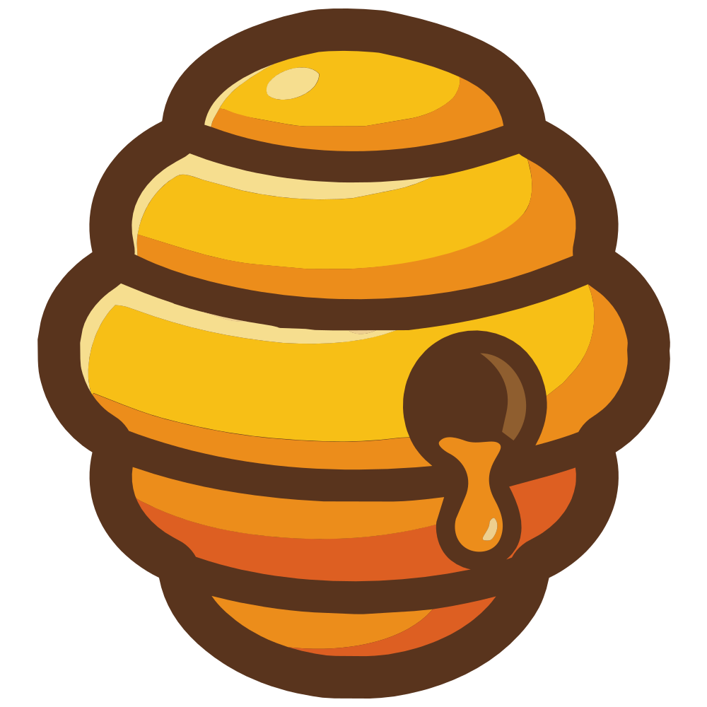
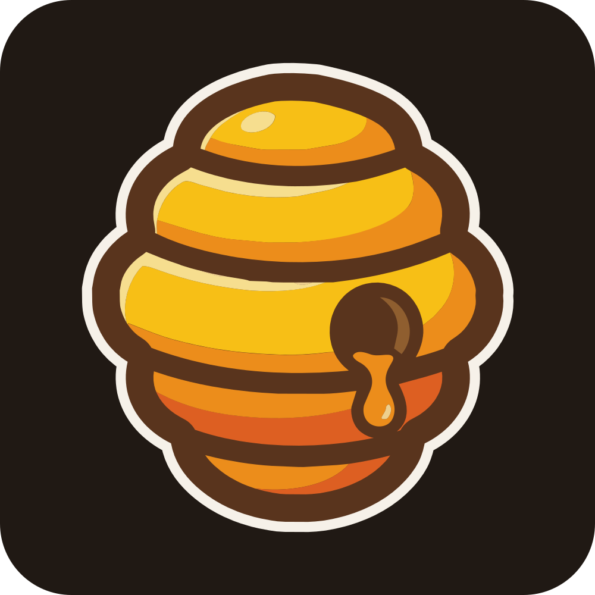
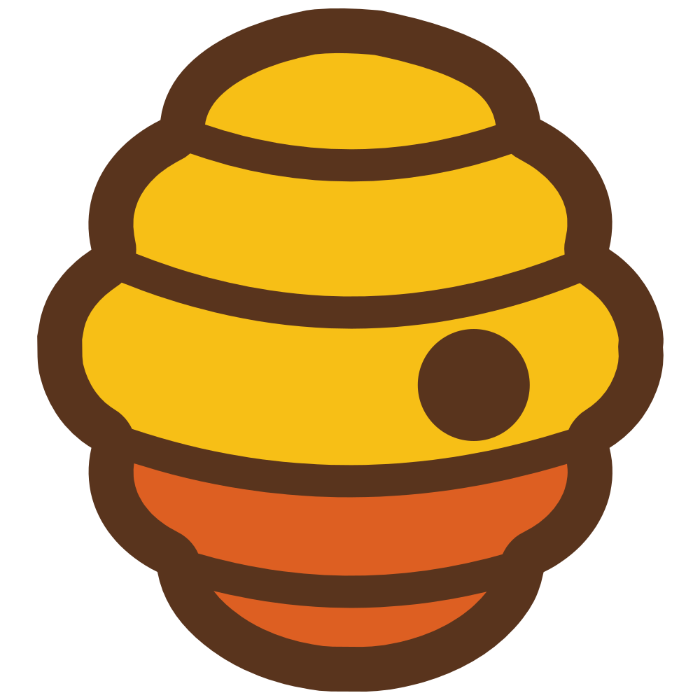
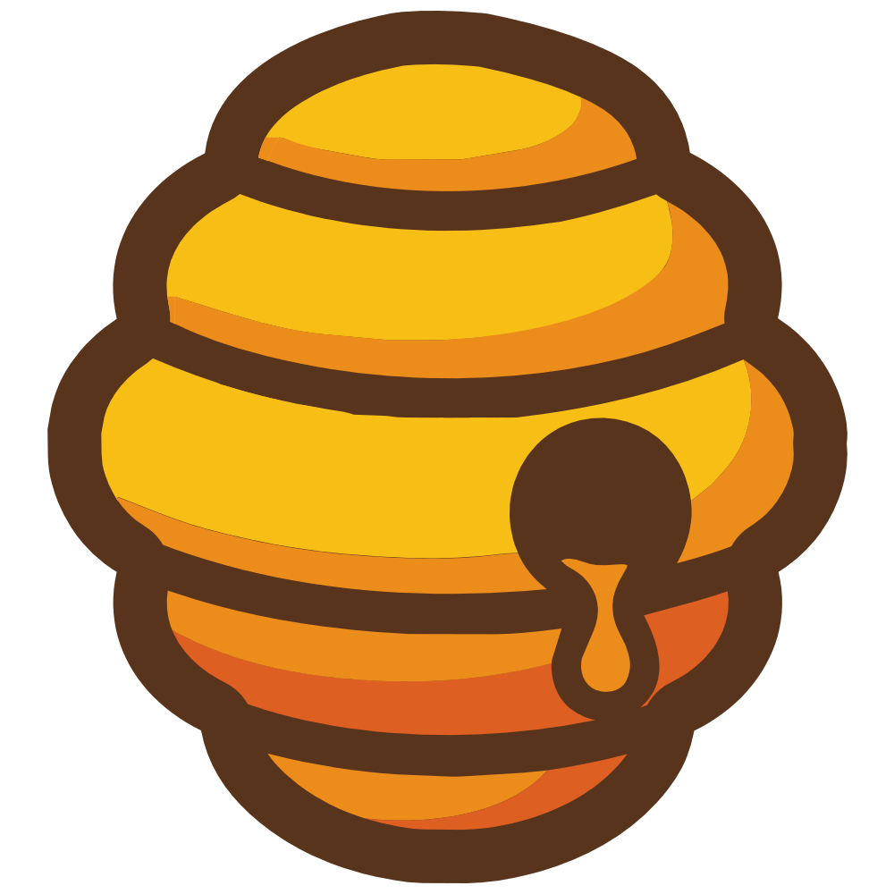
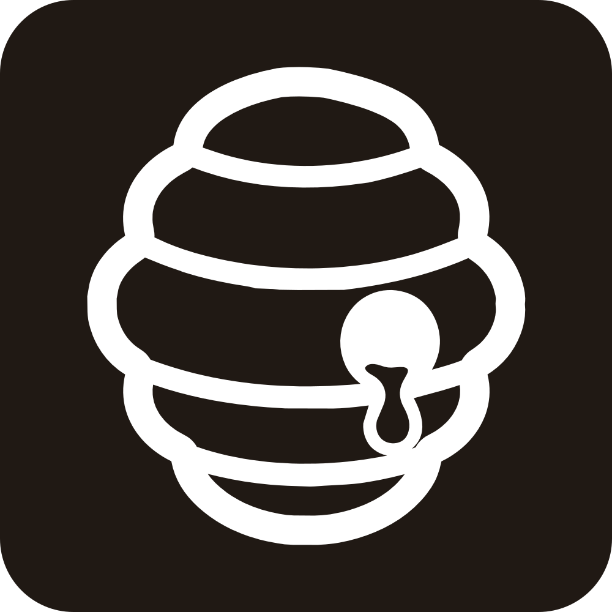

<p align="center">
  <picture>
    <source media="(prefers-color-scheme: dark)" srcset="../apps/docs/public/brand/becket-ui-lockup-on-dark.svg">
    
  </picture>
</p>

# Brand guidelines

How to write the Becket UI name, use the hive logo, and pick its colors and type. If you link to
Becket, write about it, or build something with it, this page tells you which file to use and how.
All files live in [`apps/docs/public/brand/`](../apps/docs/public/brand/).

## Name and pronunciation

**Becket UI**: say **BECK-it**, /ˈbɛkɪt/. It rhymes with "wreck it". It is not "bee-ket" and not
"buh-KET". In Spanish: _BÉ-ket_.

| Write                                                            | Don't write                                    |
| ---------------------------------------------------------------- | ---------------------------------------------- |
| Becket UI (first mention), then Becket                           | BecketUI, Becket-UI, BECKET UI, becket ui      |
| `@becket-ui/react`, `@becket-ui/tokens` (package names, in code) | Becket React, Becket Tokens (as product names) |
| Becket (one t)                                                   | Beckett                                        |

The bee is in the meaning, not the sound: the name comes from the Old English _bēo-cot_, "bee
cottage", a beehive. That is why the logo is a hive. Becket is made by Kolmena, from the Spanish
_colmena_, which also means beehive.

## The hive

The hive is the Becket UI logo. Use the files as they are: don't redraw, trace or rebuild it. The
drawing is the original artwork with its lines thickened 1.45× inward, so they carry the same weight
as the wordmark; its outline, tiers, shading and colors are unchanged.

| Version          | Preview                                                                            | Use it on                                                                                                                                                       | File                      |
| ---------------- | ---------------------------------------------------------------------------------- | --------------------------------------------------------------------------------------------------------------------------------------------------------------- | ------------------------- |
| Color            |       | White, cream, yellow and other light backgrounds. The default.                                                                                                  | `becket-hive-color.svg`   |
| On dark          |   | Dark backgrounds. The cream outline keeps the brown edge from disappearing.                                                                                     | `becket-hive-dark.svg`    |
| Favicon cut      |     | 16–48 px: favicons, tabs, small avatars, small lockups. Same outline and tier lines, drawn heavier; the hole is a solid dot, and the drip and shading are gone. | `becket-hive-favicon.svg` |
| Four inks        |       | Print with a limited number of inks (screen print, merch). The color hive without its two highlight colors.                                                     | `becket-hive-small.svg`   |
| One color, black |       | Single-color print, engraving, embroidery, stamps.                                                                                                              | `becket-hive-black.svg`   |
| One color, white |  | Single-color on dark or on a brand color.                                                                                                                       | `becket-hive-white.svg`   |

Raster copy for tools that can't take SVG: `becket-hive-color-512.png`.

## Wordmark and lockups

The wordmark is **Becket** in Comb brown with **UI** in Ember, drawn in **Becket Wordmark**: custom
lettering built on Baloo 2 ExtraBold. The letters are spaced by eye-equal area, "UI" is a step
lighter (stem 142 against 170) so it reads as the label without fading, and every letter is one
clean outline. Use the supplied files; don't retype the name in Baloo 2, it won't match.

There are three cuts:

- **Regular** for light backgrounds.
- **On dark**, 2 % thinner, because light strokes on dark grounds look heavier.
- **Small** (`becket-ui-wordmark-color-small.svg`), with looser spacing and a heavier "UI", for
  lockups under 48 px tall.

If a tool needs live text, [`font/BecketWordmark-Regular.woff2`](../apps/docs/public/brand/font/)
types "Becket UI" with the exact logo spacing. It holds only those letters, and it can't color "UI"
for you. It's licensed under the SIL Open Font License, like Baloo 2.

| Lockup                               | Light background                   | Dark background                  |
| ------------------------------------ | ---------------------------------- | -------------------------------- |
| Horizontal (primary)                 | `becket-ui-lockup-color.svg`       | `becket-ui-lockup-on-dark.svg`   |
| Horizontal, small (under 48 px tall) | `becket-ui-lockup-small-color.svg` | –                                |
| Horizontal, without "UI"             | `becket-lockup-color.svg`          | `becket-lockup-on-dark.svg`      |
| Stacked (square spaces)              | `becket-stacked-color.svg`         | `becket-stacked-on-dark.svg`     |
| Wordmark only                        | `becket-ui-wordmark-color.svg`     | `becket-ui-wordmark-on-dark.svg` |
| One color                            | `becket-ui-lockup-black.svg`       | `becket-ui-lockup-white.svg`     |

PNG copies at 256 px tall: `becket-ui-lockup-color@4x.png`, `becket-ui-lockup-on-dark@4x.png`.

Drop "UI" only where the context already says it, such as next to the npm package name. On dark
backgrounds the wordmark turns cream and "UI" turns Honey. In one color both words share the color.

### Clear space

The lockup sits on a grid where **u** is the width of a lowercase stem: the hive is 8u tall, the
capitals are 3.63u, and the gap between hive and word is 2u. Keep a margin of 2u (a quarter of the
hive's height, about one ring) on every side. Text, edges and other logos stay outside it.

### Minimum size

| Asset                       | Screen     | Print      | Smaller than that         |
| --------------------------- | ---------- | ---------- | ------------------------- |
| Hive, color                 | 48 px      | 12 mm      | Use the favicon cut       |
| Hive, favicon cut           | 16 px      | 5 mm       | Don't use the logo        |
| Horizontal lockup           | 48 px tall | 12 mm tall | Use the small lockup      |
| Small lockup                | 16 px tall | 5 mm tall  | Use the favicon cut alone |
| Stacked lockup              | 64 px tall | 16 mm tall | Use the hive alone        |
| One-color hive, embroidered | –          | 15 mm wide | Don't embroider it        |

## Color

The brand colors are the hive's own, plus two neutrals from `@becket-ui/tokens`.

|                                                                             | Name   | HEX       | RGB         | Use                                                              |
| --------------------------------------------------------------------------- | ------ | --------- | ----------- | ---------------------------------------------------------------- |
|   | Honey  | `#F7BF16` | 247 191 22  | Main accent on dark. Never text on light.                        |
|   | Amber  | `#EC8D1B` | 236 141 27  | Secondary accent, highlights on dark.                            |
|   | Ember  | `#DD5F22` | 221 95 34   | "UI" in the wordmark. Links and focus on light, large text only. |
|    | Comb   | `#59341D` | 89 52 29    | The hive's outline. Wordmark and headings on light.              |
|     | Wax    | `#F6DE8F` | 246 222 143 | Soft fills on dark. Never text on light.                         |
|  | Hollow | `#8F5E2F` | 143 94 47   | Secondary text on cream.                                         |
|     | Ink    | `#201914` | 32 25 20    | `neutral.900`. Dark canvas, body text on light.                  |
|   | Cream  | `#F6F1E9` | 246 241 233 | `neutral.50`. Light canvas, text on dark.                        |

Brand surfaces (site, README art, social cards, slides, print) are mostly Ink and Cream, with Honey
as the main accent and Amber, Ember and Comb in small amounts.

### Contrast

Measured against WCAG 2.2.

| Pair                        | Ratio  | Good for                     |
| --------------------------- | ------ | ---------------------------- |
| Ink on Cream / Cream on Ink | 15.4:1 | Any text                     |
| Comb on white               | 10.9:1 | Any text                     |
| Honey on Ink                | 10.3:1 | Any text                     |
| Amber on Ink                | 6.9:1  | Any text                     |
| Hollow on Cream             | 4.9:1  | Any text                     |
| Ember on Ink                | 4.7:1  | Any text                     |
| Ember on white              | 3.7:1  | Large text and UI marks only |
| Amber on white              | 2.5:1  | Decoration only              |
| Honey on white              | 1.7:1  | Decoration only              |

### Brand colors and component tokens

These colors are for brand surfaces. Inside an app, use the tokens: `--beckui--colors-primary`
(`becketYellow`, `#E1A01D`) is a deeper honey than the logo's Honey, tuned so filled controls pass
AA in both themes. See [Theming](./THEMING.md).

## Typography

| Face                  | Where                                                                                                                                                      |
| --------------------- | ---------------------------------------------------------------------------------------------------------------------------------------------------------- |
| Baloo 2 ExtraBold     | Display headlines on brand surfaces (site hero, social cards, slide titles). The logo itself is Becket Wordmark. Never body text, never inside components. |
| Inter 400 / 600 / 700 | Everything else: docs, README, the components themselves (`fonts.sans`).                                                                                   |
| JetBrains Mono 400    | Code, install commands, token names (`fonts.mono`).                                                                                                        |

All three are free under the SIL Open Font License, on Google Fonts.

## Ring bands

From top to bottom the hive goes Honey, Amber, Ember. The ring band repeats that order as three
equal stripes. It is the only graphic element besides the hive (`becket-rings-flat.svg`).

- Use it along the edge of a header, footer, social card or slide, edge to edge, at 1–3 % of the
  surface's height.
- Keep the order and keep the stripes equal.
- Don't add hexagons, honeycomb patterns, bees or other characters. Don't curve it, put a gradient
  on it, or put text over it.

## Using the name and logo

You may use the Becket UI name and logo, unchanged, to:

- link to Becket UI or its docs;
- write, post or teach about Becket UI;
- show that your project is built with Becket UI.

Don't use them to:

- suggest that Kolmena or Becket UI made, sponsors or endorses your project;
- name a product, package, company or domain (for example "Becket Pro" or `becket-ui-plus`);
- make a modified version of the hive or the wordmark.

The MIT license covers Becket's code. It doesn't grant rights to the name or the logo beyond the
uses above.

## Don't

- Stretch, squash, rotate or tilt the logo.
- Recolor it, or add shadows, glows, bevels or outlines.
- Remove the brown outline.
- Put the color hive on a dark or mid-tone background: use the on-dark version.
- Put the logo inside a hexagon, badge or shape.
- Place it on photos or busy patterns.
- Retype the wordmark or change its colors.

## Writing about Becket

Plain English, short sentences, code before adjectives. Say what Becket is and what it isn't. Quote
sizes and numbers from a fresh measurement, not from memory. Avoid claims you can't show: "zero-JS",
"faster than", "the first".

## Embedding the logo

In a README or docs page, switch with the reader's color scheme:

```html
<picture>
  <source
    media="(prefers-color-scheme: dark)"
    srcset="
      https://raw.githubusercontent.com/kolmenadev/becket-ui/main/apps/docs/public/brand/becket-ui-lockup-on-dark.svg
    "
  />
  
</picture>
```

Alt text is always "Becket UI".
