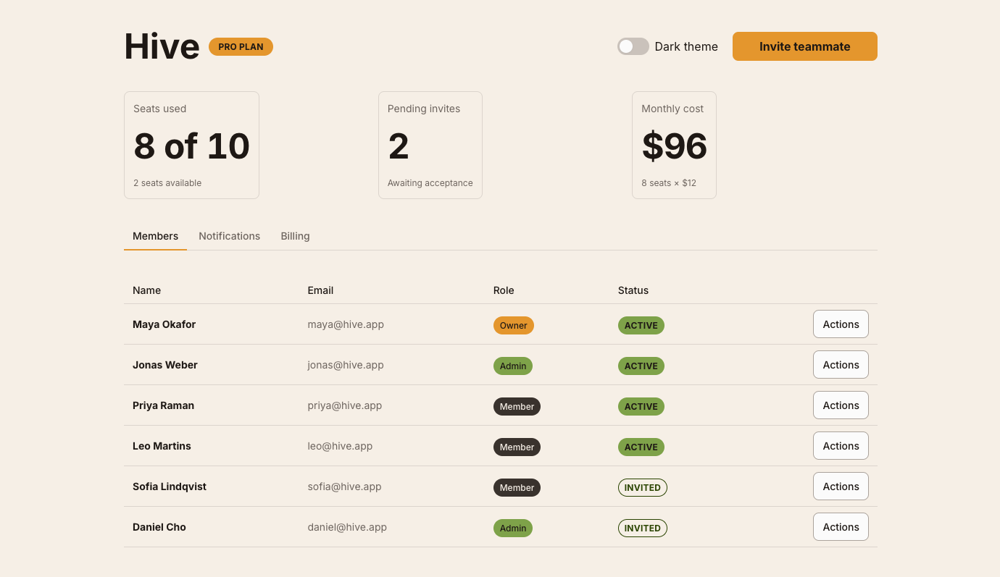
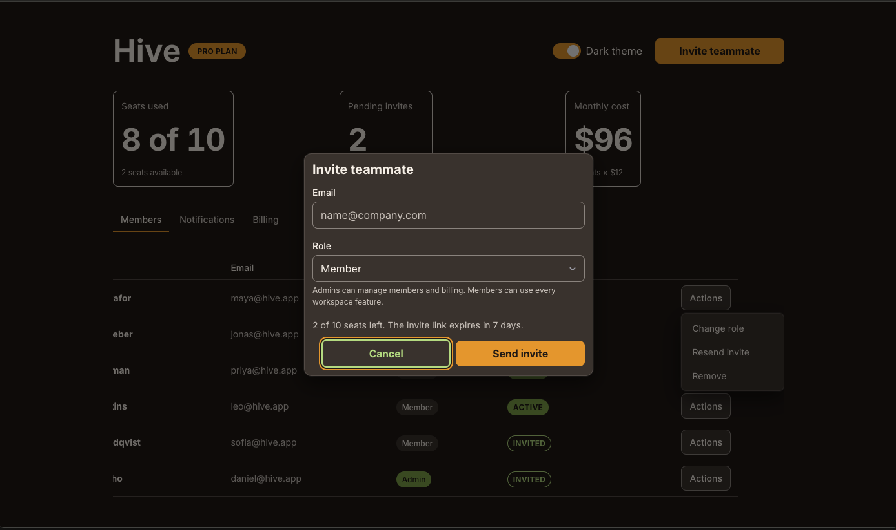

# Use Becket UI in Claude Design

[Claude Design](https://claude.ai/design) can build screens with Becket's real components instead of
generic ones. It reads a **design-system project** that Claude Code's `/design-sync` command builds
from this repo and uploads to your account.

Everything the sync needs is committed in `.design-sync/` (config, fix notes, the guide the design
agent reads first), so anyone with a **Claude Pro or Max** plan can make their own copy.

## What you need

- A Claude Pro or Max plan with Claude Design enabled.
- [Claude Code](https://claude.com/claude-code), recent enough to include `/design-sync` (run
  `claude update`).
- Node `>=22.12` and pnpm 12 (`corepack enable` picks up the pinned version).
- Time and plan usage for the first sync: it renders every component and checks it against
  Storybook, which can take an hour or more.

## Set up your copy

1. **Clone and install.**

   ```bash
   git clone https://github.com/kolmenadev/becket-ui.git
   cd becket-ui
   pnpm i --frozen-lockfile
   ```

2. **Unpin the maintainers' project.** `.design-sync/config.json` holds the `projectId` of Kolmena's
   own Claude Design project, which you can't write to. Remove it locally, then tell git to ignore
   your local copy of the file so your own id never gets committed:

   ```bash
   node -e "const f='.design-sync/config.json',fs=require('fs'),c=JSON.parse(fs.readFileSync(f,'utf8'));delete c.projectId;fs.writeFileSync(f,JSON.stringify(c,null,2)+'\n')"
   git update-index --skip-worktree .design-sync/config.json
   ```

3. **Start Claude Code in the repo and log in to Claude Design.** In an interactive `claude`
   session, run `/design-login` once and follow the prompt.

4. **Run the sync.** In the same session:

   ```text
   /design-sync
   ```

   Claude explains the process, asks you to name a new project (for example "Becket UI"), and asks
   for one approval to upload. Verified components then show up in the project while the run
   continues. When it finishes, it gives you the project link and writes your new `projectId` into
   your local config.

5. **Design with it.** Open the project in Claude Design and start designs from it. Ask for screens
   in plain language ("a settings page with tabs, a table and switches"). The agent builds them from
   `window.Becket` components and Becket tokens, in dark (default) or light theme. When a design is
   ready, hand it off to Claude Code; the code it writes imports from `@becket-ui/react` and
   `@becket-ui/tokens/index.css`.

## Try it: a showcase prompt

This prompt exercises most of the kit in one screen: layout, typography, cards, tabs, a table with
tags and badges, a menu, form controls, a dialog and both themes. Paste it into a new design in your
Becket UI project:

```text
Design a team settings page for a SaaS workspace called "Hive".

Header: the workspace name as a heading, a "Pro plan" badge next to it, and on the right a
light/dark theme toggle and a primary "Invite teammate" button.

Below the header, three stat cards in a responsive grid: seats used (8 of 10), pending invites (2)
and monthly cost ($96).

Then tabs: Members, Notifications, Billing.
- Members: a table of six people with name, email, a role tag (Owner, Admin, Member), a status
  badge (Active or Invited) and an "Actions" menu on each row (Change role, Resend invite, Remove).
- Notifications: switches for email, push and weekly digest; a checkbox for product updates; and a
  radio group for digest frequency (daily, weekly, monthly) with a short helper line.
- Billing: a card with the current plan, next invoice date, a separator, and an outline
  "Change plan" button.

"Invite teammate" opens a dialog with an email field, a role select, helper text and
Cancel / Send invite buttons.

Use only Becket UI components and tokens, start in dark theme, and make sure the toggle switches
the whole page to light.
```

Light theme, Members tab:



Dark theme, with the invite dialog and a row's Actions menu open:



Results vary from run to run. Things to check in yours: every control is a Becket component (no
hand-made buttons or inputs), colors come from tokens (the toggle repaints the whole page), and the
Members table, tabs and dialog keep the Becket look in both themes.

## Get the React code

A design in Claude Design runs on a browser build of Becket (`window.Becket`). To turn it into code
for your app, hand it off to Claude Code:

1. In your app's repo, install Becket and load its CSS once:

   ```bash
   pnpm add @becket-ui/react @becket-ui/tokens
   ```

   ```ts
   import "@becket-ui/tokens/index.css";
   ```

2. In Claude Design, open **Export** and choose **Hand off to Claude Code**. It packages the design
   (screens, component choices, intent) and gives you a command or link for Claude Code, local or on
   the web.
3. Run it in a Claude Code session opened in your app's repo. Claude Code rebuilds the screens there
   with real imports, for example `import { Button, Card, Tabs } from '@becket-ui/react'`, and keeps
   `data-theme` on `<html>` for dark and light.
4. Review it like any PR. Look for raw `<button>`/`<input>` elements, hex colors or copied
   `.beckui--*` class names where a Becket component or token should be.

Other exports (standalone HTML, PDF, PPTX) are for sharing and review. The HTML export is a
prototype that still runs the `window.Becket` browser build, so don't ship it as app code.

## Keep your copy current

Your project is a snapshot of the commit you synced. It doesn't update when Becket does, so each
copy drifts on its own until you re-sync it.

After pulling new Becket changes, run `/design-sync` again. Your local `projectId` points it at your
project, and it re-checks only the components that changed, then updates the project in one pass.

If `git pull` stops because `.design-sync/config.json` changed upstream, re-apply your unpin around
the pull:

```bash
git update-index --no-skip-worktree .design-sync/config.json
git stash push .design-sync/config.json
git pull
git stash pop
git update-index --skip-worktree .design-sync/config.json
```

## Good to know

- **Never commit your `projectId`.** It only works for your account. Pull requests that improve the
  sync itself (`.design-sync/config.json` settings other than `projectId`, `NOTES.md`,
  `conventions.md`) are welcome.
- **Expected warning:** `[FONT_MISSING] "Cambria"` is a serif fallback that no Becket component
  uses. It's safe to ignore.
- **No provider needed.** If the generated README mentions Storybook decorators or theme providers,
  ignore it: Becket is styled by compiled CSS, and the project's guide says so first.
- **Sign-in errors** mean the Claude Design login expired: run `/design-login` again.
- **"Project not found" or a permission error** usually means step 2 was skipped and the sync is
  trying to reach Kolmena's project.
- **Teams:** on a Claude Team or Enterprise plan, an admin-approved design system applies to every
  member's projects, so one sync serves everyone and nobody needs their own copy.
